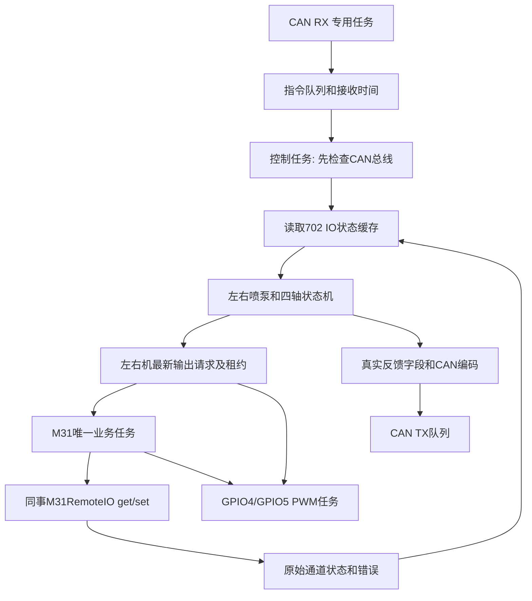

# 702 应用层准备工作审核

日期：2026-10-24

目标工程：`C:\RT-ThreadStudio\VSWorkSpace\esp32s3_industry-main (1)\esp32s3_industry-main`

本次按“补齐尚未准备好的部分”实施。原工程只作为 CAN、状态机和通道文档的来源，未修改原工程。当前默认配置能启动 CAN 接收、M31 采集、诊断和状态机调度；四轴保持 Disabled，DO/AO 写入与 GPIO4/5 PWM 附着均未启用。机械动作需要完成本页的现场配置审核。

## 1. 本次完成

| 部分 | 实现与入口 |
|---|---|
| CAN 传输 | 保留原 RX/TX 专用任务；接入开机初始化；RX 保留底层接收时间；TX 队列中超过 200ms 的旧状态帧丢弃 |
| CAN 指令 | `can/702_can_protocol.*` 解析左右机权限、翻斗、转舵、油门、合排、反冲、发动机启停和三个备用发动机字段 |
| 指令状态 | 每台喷泵分别保存 `authority_command` 和 `motion_command`，包含接收时间及当时是否被状态机接受；权限帧不会覆盖上次运动字段 |
| CAN 状态编码 | 四类状态帧的 ID、偏移、单位、大小端和 SPN/FMI 位定义已实现；缺字段、过期、越界及协议布局未确认分别阻止发送 |
| IO 采集 | `io/702_io_service.*` 提供 `get_702_io()`、`set_702_io()`，轮询 4 DI、6 AI、4 DO 回读和2 AO 回读 |
| IO 状态 | 每通道保存上次成功值、采样时间、最近尝试时间、错误码和有效性；采集失败保留旧原始数值但撤销有效性 |
| 标定与映射 | `702_signal_map.h` 管接线；`702_config.cpp` 管左右机标定、报警极性、AO/PWM/DO 参数；应用层使用对象名和物理量 |
| 输出顺序 | 独立纯逻辑 `OutputSequence`：双 DO 先停、AO 回安全值，再执行目标；换向、请求替换和租约超时重走停止顺序 |
| 输出失败 | 写失败锁存输出故障并记录执行不确定；只尝试安全输出；某一路停止失败仍继续尝试其它停止通道 |
| PWM | GPIO4/5 独立任务独占 LEDC，10ms 检查请求；网络同步调用阻塞期间仍检查本地 PWM 租约 |
| 状态机 | 移入原工程 `AxisControl / PumpControl / PumpRuntime / PumpLink`；接上真实缓存接口及 CAN 总线门控 |
| 诊断 | Shell 命令 `702_status`、`702_reset left`、`702_reset right`；复位命令只排队，接受/拒绝计数可查询 |
| 启动 | ino 在 W5500 初始化后、Shell 初始化前调用 `App702::Start(Make702Config())` |

`dout` 命名空间保留。C++ 的 `do` 是关键字，不能作为命名空间名称。

## 2. 分层与调用顺序



- 控制任务周期20ms，不执行 Modbus 请求。
- M31 所有调用都在一个任务内串行执行，包括对象构造；每轮最多处理每侧一条输出事务和一个输入通道。
- 控制任务先判断总线，再读取缓存、推进状态机、提交 DO/AO/PWM 请求，最后按200ms周期发布可编码的状态。
- CAN 警告、被动错误、bus-off 或状态查询失败均停止动作。运行中失去总线后锁存故障；RX 任务持续运行以支持底层恢复。
- 底层 RX 丢帧计数增加或应用队列溢出，清空旧队列并锁存故障。故障恢复仍需复位和新的权限、运动指令。
- `StopPolicy::Together` 目前表示任一侧**锁存故障**导致两侧停止；单侧权限/运动超时先停止该侧。需要“任一等待也双停”时可在状态机政策层调整。

## 3. 同事模块提供了什么

当前磁盘上的接口是构造函数传参，**没有最初头文件示例中的 Config 结构体**：

```cpp
M31RemoteIO(IPAddress Ip, uint16_t Port = 502, uint8_t UnitId = 1, uint32_t ConnectTimeoutMs = 1000, uint32_t ResponseTimeoutMs = 1000);
```

| 同事接口 | 702 层如何使用 |
|---|---|
| `get_di / get_do / set_do` | 报警采集、倒斗 DO 输出和寄存器回读 |
| `get_ai_current` | 电流整数 µA，保存原值，再按独立标定转换位置/角度/压力 |
| `get_ai_voltage` | 同事已提供；当前通道表按电流接入，未调用 |
| `get_ao_current / set_ao_current` | 电流整数 µA；转舵 AO 输出及寄存器回读 |
| `IoResult` | 每个通道和写事务保留结果；仅 Ok 更新成功采样值 |
| PImpl/同步TCP实现 | 保留原文件，702 层负责启动时机、轮询、缓存、串行任务和应用状态 |

`Disconnected` 在同事当前实现中是保留枚举；702 层另外公开 `network_ready`，避免把所有网络问题都归为某一个底层返回码。

## 4. 开发时主要使用的结构体和函数

| 名称 | 用途 |
|---|---|
| `App702::get_702_can()` → `CanStatus` | 总线结果、TWAI统计、应用计数、左右状态机状态和两类指令历史 |
| `App702::get_702_io()` → `IoStatus` | 两侧原始采集、归一化位置、角度、压力、DO/AO回读、PWM状态及写结果 |
| `Io702::set_702_io(Side, Drive)` | 底层应用适配入口，提交最新输出请求；运行时由状态机的 `Apply` 调用，业务代码不要另设竞争写入者 |
| `Drive` | 对象方向、力度、序号、签发时间和有效期；0方向代表配置的安全输出 |
| `OutputSample / AxisAck` | 独立执行反馈，必须有实际证据、对应请求序号及采样时间 |
| `IoHooks` | 接入现场限位、执行反馈和故障排除证据；回调只读取缓存，不等待网络 |
| `App702::set_702_status(Side, PumpStatus)` | 补充其它设备真实反馈，供编码器使用；当前 IO 负责的角度和液压压力由 IO 层覆盖 |
| `ResetPump(Side)` | 排队申请故障复位；当时是否满足全部恢复条件由控制任务决定 |
| `Make702Config()` | 集中配置入口；以后改标定/输出映射主要改这个文件 |
| `702_signal_map.h` | 接线变更的唯一通道表入口，沿用已确认的零基索引和GPIO4/5 |

`command_accepted` 只说明那一帧当时被控制器接受；当前可否动作还要看 mode、wait、faults、unmanned 和各 age。油门/发动机等字段被解析不意味着已有执行器输出。

`write_complete` 只说明该次输出序列收到正常通信结果；DO/AO 回读也只是设备寄存器。它们都不等于 `AxisAck.valid`，不证明线圈、阀芯或机械已按指令动作。

## 5. 你需要审核/提供的现场项

### 5.1 参数和真实反馈

1. 左右翻斗和左右转舵：4–20mA 的低、中、高三点及对应实际角度。电流可以随位置递增或递减；越界不做强行裁剪。
2. 左右压力变送器：工程量满量程。采集原始电流已经可用；未填写量程时压力有效位保持false。
3. 四路报警的有效电平。当前只有原始DI值，`alarms_ready=false`。
4. 双DO线圈有效电平、上下方向、停止组合；AO负向/中位/正向电流；GPIO4/5 PWM频率、分辨率和两向/停止占空比（0..1000）。
5. 限位和执行反馈来源。当前四路DI已被报警占用，通道表没有为限位或独立执行确认分配输入；`pump_limits/pump_feedback/pump_recovered` 保留为空。
6. 四轴动作参数：容差、力度、确认超时、行程超时、位移监测和换向等待。目前 `AxisSettings` 全零。左右机当前共用控制参数，两侧 IO 标定及输出映射分别配置。
7. M31 断网保护/远端输出看门狗的实际设置和现场验证结果。同步 Modbus 调用可能长时间等待，ESP32 无法在失联时保证远端 DO/AO 已停止；软件停止请求不能代替远端保护。已经进入同步调用的那一条命令无法由当前适配层撤销，可能在请求过期或撤权后才到达远端，必须纳入现场停机时序验收。

GPIO4/5 使用你指定的板载0–5V DO输出路径。软件中的占空比作用于 ESP32 的 GPIO/LEDC；板级反相、上拉、电平转换和安全上电状态需要连同放大板一起验证。未配置时软件不附着 PWM。

### 5.2 CAN 状态资料缺口

依据 `PJ400无人控制通信协议_20260903.docx`：

- 位置帧的转速使用字节5..7，但分辨率和量程只覆盖16位数值。当前支持“24位大端、有效量程0..65520、无效速度65535”的实现选项，`speed_layout=false` 等待确认。
- 多处备用字节/位没有指定发送值。`reserved_layout=false` 等待确认；模板 `reserved_value=0xFF` 不是已经确认的现场约定。
- 合排/反冲实际状态、发动机转速、齿轮箱油压温度、阀芯位置、液压运行状态和 SPN/FMI 无已确认采集来源。结构体、编码器和数据入口已完成，字段默认无效。
- 液压压力来自既有AI；AO电流不被用作阀芯位移。内部状态机故障位也不会冒充协议SPN。
- 状态帧所需数据不齐时整帧跳过，并增加 `not_ready`；不会补零伪造正常状态。
- 文档总述为主从应答，表格又规定状态200ms周期。当前沿用200ms周期实现；若对端要求逐帧即时应答，需要再明确各请求对应的应答规则。

当前默认运行时通常没有可发送的完整状态帧；可先用 `702_status` 和 `get_702_io()` 审核接收及采集。

## 6. 已完成的验证

- 使用本机 Arduino ESP32 3.3.12 对应的 xtensa GCC，对10个应用 .cpp 和 ino 共11个编译单元执行 `-fsyntax-only`，通过。
- 33个编译期逻辑场景通过，实际生产函数体保持不变，仅在编译输入中添加 constexpr，以便求值检查。
- 覆盖：全部运动字段、权限/帧长度/边界、指令历史、授权失效、总线故障撤权、压力/位置/故障帧金样、缺失和过期状态、反向标定、压力范围、输出极性和力度、毫秒回绕、先停后动、保活、停止失败、换向/过期取消旧序列，以及原有14个轴状态机场景。
- 同事的 M31、W5500、TWAI底层、Shell和LED代码按哈希核对保持一致。
- 未执行完整固件构建、链接、烧录、CAN注入、网络连接或实际动作。你此前要求整机构建由你完成。
- 本次新增独立准备层测试，并复用原有14个轴状态机场景；原工程测试文件未改写。

复查逻辑测试：

```powershell
python tests/check_702.py "<xtensa-esp32s3-elf-g++路径>"
```

这项检查在编译器内验证状态变化，不代表已经验证 FreeRTOS 实际调度、网络最坏延迟或硬件反馈。

## 7. 文件清单与回退

具体新增/修改文件及哈希见同目录 `702_prepare_manifest.json`。 当前环境下，PowerShell 对部分源码读到带二进制头的内容，Python 可读取实际源码；清单哈希统一以 Python 读取的源码字节为准。

原文件备份放在目标工程的同级目录 `702_prepare_backup_20261024`。只修改已有的 ino、`702_can_service.h`、`702_can_service.cpp`；其余均新增。

回退时先停止使用正在构建的工程，按manifest从备份恢复modified条目，再删除added条目。仅处理本次清单中的文件，保留你审核后新增的其它改动。本次没有执行回退。

## 8. 下一步应用规则

现在可以围绕 `Snapshot + IoStatus + Command` 审核和补充业务规则：压力允许范围、报警的联锁政策、合排/反冲/发动机的实际执行通路、人工/无人切换策略，以及故障SPN映射。现有四轴状态机已连接准备层；上述规则和现场标定完成后再开展受控联调。
